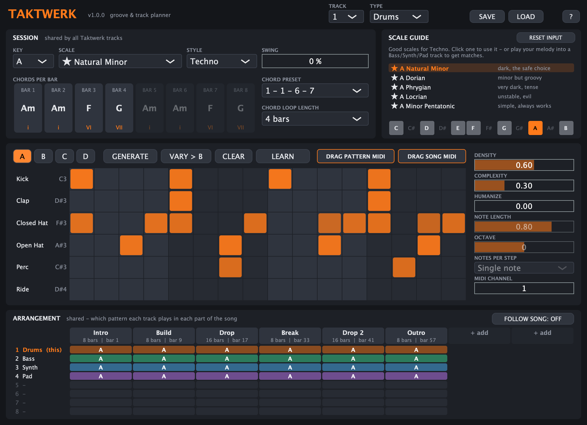

# Taktwerk

Groove and track planner for techno / hard techno / uptempo. Taktwerk makes no sound itself: it writes drum, bass, synth and pad patterns and sends them as MIDI to your own instruments. VST3, macOS (Apple Silicon + Intel), made with JUCE.



## What it does

- **Four track types** – Drums (6 lanes, 16 steps), Bass, Synth and Pad. Load one Taktwerk per track, up to 8.
- **Shared session** – key, scale, style, swing and the chords per bar are shared by all Taktwerk instances in the project, so bass, synth and pad always follow the same progression.
- **Generate and vary** – GENERATE makes a new pattern in the chosen style (Techno, Hard Techno, Psytrance, Hardstyle, Uptempo, Trance, House); VARY copies it to the next slot with small changes for fills and build-ups. DENSITY and COMPLEXITY steer how busy it gets.
- **Scale guide** – suggests scales that fit the style, or play your melody in and it shows which scales match.
- **Learn** – records notes you send to Taktwerk into the pattern while the host plays, snapped onto the scale.
- **Arrangement** – plan the song in parts (Intro, Build, Drop ...) and pick pattern A–D per track and part; FOLLOW SONG plays it back from the host's song position.
- **MIDI export** – drag the current pattern or the whole song into the piano roll or playlist.
- **Presets** – saved to `~/Library/Audio/Presets/Taktwerk`.

Every control has a tooltip, and the `?` button shows a quick start.

## Connecting it in FL Studio

Taktwerk only sends notes, so it needs an instrument to play them.

- **MIDI ports:** in Taktwerk's wrapper settings set the MIDI *Output port* to a number, and set the instrument's *Input port* to the same number. Use a different port for every Taktwerk.
- **Patcher:** put Taktwerk and the instruments in one Patcher, set Taktwerk's MIDI Output port, then right-click Taktwerk > Outputs > Events, switch the MIDI port on and drag a cable to the instrument.

## Build

Needs Xcode and CMake. JUCE is downloaded automatically.

```bash
cmake -S . -B build -DCMAKE_BUILD_TYPE=Release
cmake --build build --target Taktwerk_VST3 TaktwerkTest -j 10
```

Install:

```bash
cp -R build/Taktwerk_artefacts/Release/VST3/Taktwerk.vst3 ~/Library/Audio/Plug-Ins/VST3/
```

Then run "Find installed plugins" in FL Studio's plugin manager.

## Test

`TaktwerkTest` runs the plugin without a host, checks the generated notes (kick on the beat, notes in scale, chord changes, swing, arrangement, learn, state, MIDI export) and renders the editor to PNG files:

```bash
./build/TaktwerkTest_artefacts/Release/TaktwerkTest "$PWD/screenshots"
```

## Note

JUCE is free for personal use and under its own licence for anything commercial; see https://juce.com/get-juce.
